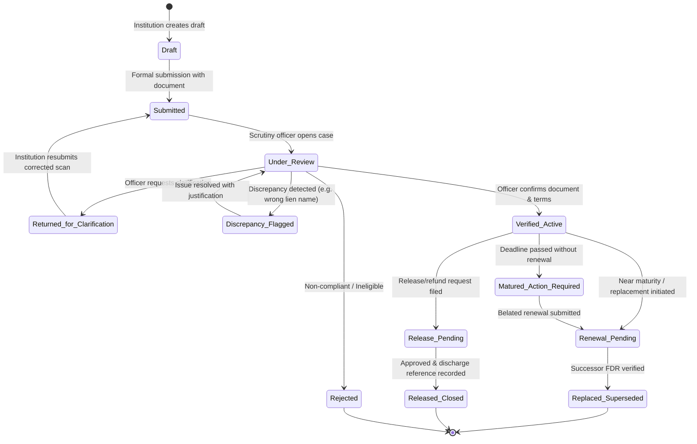
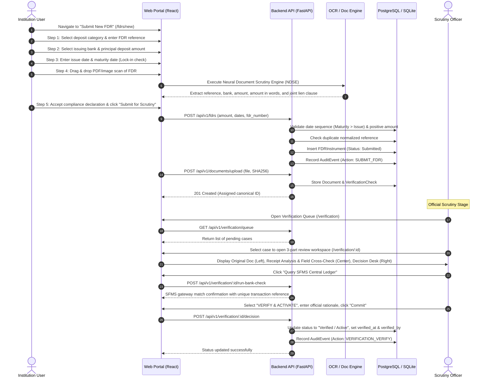
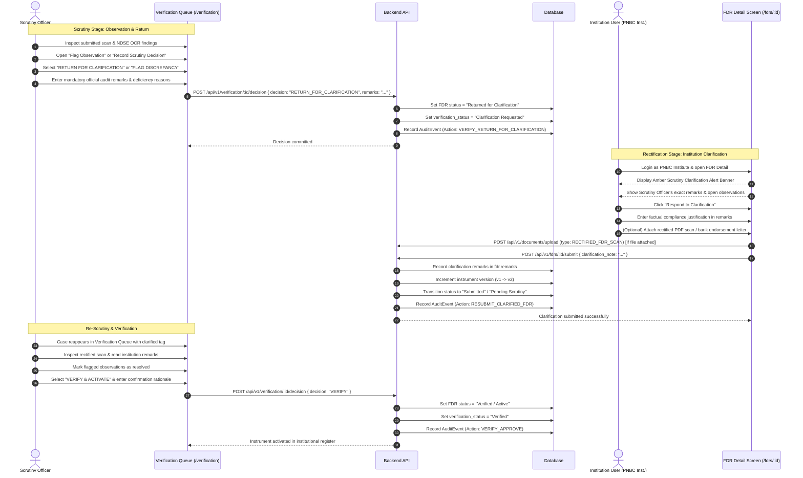
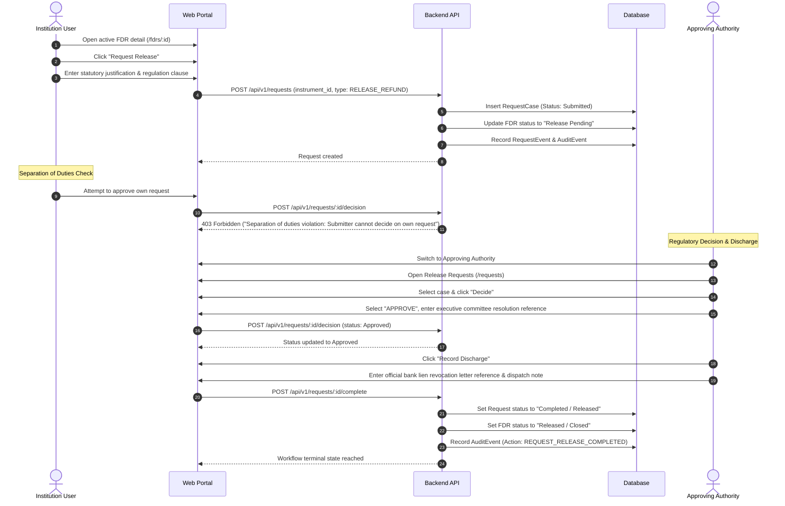
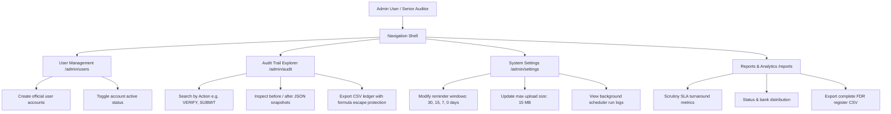

# FINTRAC — AICTE Security Deposit / FDR Management Portal
## Comprehensive User Flows & Operational Runbook
### Problem Statement 26265 | AICTE Regulation Bureau
**The Financial Control Room — Clarity, Control and Compliance**

---

## Table of Contents
1. [System Overview & Operating Principles](#1-system-overview--operating-principles)
2. [User Personas & Role Matrix](#2-user-personas--role-matrix)
3. [Instrument Lifecycle State Machine](#3-instrument-lifecycle-state-machine)
4. [User Flow A: New FDR Submission & Scrutiny Workflow](#4-user-flow-a-new-fdr-submission--scrutiny-workflow)
5. [User Flow B: Scrutiny Discrepancy & Clarification Rectification Workflow](#5-user-flow-b-scrutiny-discrepancy--clarification-rectification-workflow)
6. [User Flow C: Maturity Monitoring & Linked Renewal Replacement](#6-user-flow-c-maturity-monitoring--linked-renewal-replacement)
7. [User Flow D: Release / Refund Request & Administrative Discharge](#7-user-flow-d-release--refund-request--administrative-discharge)
8. [User Flow E: Audit Trail Explorer, System Settings & Scheduled Sweeps](#8-user-flow-e-audit-trail-explorer-system-settings--scheduled-sweeps)
9. [Step-by-Step Operating Guide (How to Run & Demonstrate)](#9-step-by-step-operating-guide-how-to-run--demonstrate)
10. [Security Guardrails & Error Recovery](#10-security-guardrails--error-recovery)

---

## 1. System Overview & Operating Principles

The **AICTE Security Deposit / Fixed Deposit Receipt (FDR) Management Portal** centralizes institutional security deposits, replaces manual paper tracking, enforces date-driven maturity monitoring, and provides an auditable, multi-role regulatory workspace.

### Core Operating Principles:
1. **One Source of Truth**: Every instrument has a single canonical database record. Once submitted, historical records are immutable; renewals link predecessors to successors rather than overwriting existing records.
2. **Human Accountability**: AI and OCR document extractions act as suggestions only. Certified Scrutiny Officers and Approving Authorities retain authoritative decision-making responsibility.
3. **Least Privilege & Institution Scoping**: Institution users can strictly view and manage only records belonging to their assigned institution (`institution_id`). Attempts to access other institutions' records are blocked at the backend API level.
4. **Separation of Duties**: The user who created or submitted a release/refund request is strictly prohibited from approving that same request.
5. **Integrated External Gateways**: The portal connects to the Structured Financial Messaging System (SFMS) for inter-bank e-FDR lien registration checks and applies native PDF text and image extraction via the AICTE Neural Document Scrutiny Engine (NDSE).

---

## 2. User Personas & Role Matrix

The platform is designed around 5 distinct operational personas. All seeded accounts use the default password: **`Password@123`**.

| Persona | Seeded Account | Scope & Permissions | What They Do |
| :--- | :--- | :--- | :--- |
| **Institution User** | `institution@aicte-demo.in`<br>*(Dr. Ramesh Sharma)* | Scoped strictly to own institution (*PNBC Institute of Technology, AICTE-DL-001*). | Submits new FDR drafts, uploads original deposit scans, monitors maturity dates, requests renewal replacements, responds to discrepancy queries, and submits release requests. |
| **Scrutiny Officer** | `verifier@aicte-demo.in`<br>*(Smt. Sunita Rao)* | Regulation Bureau Regional Scrutiny Desk. | Inspects uploaded documents, compares OCR suggestions against submitted metadata, executes simulated core banking ledger checks, flags discrepancies, returns cases for clarification, or verifies instruments. |
| **Approving Authority** | `approver@aicte-demo.in`<br>*(Prof. Anil Sahasrabudhe)* | AICTE Regulation Bureau HQ. | Evaluates routed release and refund requests, verifies eligibility criteria, approves or rejects with mandatory justification, and confirms official administrative discharge. |
| **Portal Administrator** | `admin@aicte-demo.in`<br>*(System Administrator)* | System-wide IT Operations & Security. | Provisions user accounts, configures reminder windows and upload limits, triggers proximity sweeps, monitors worker jobs, and oversees platform health. |
| **Senior Auditor** | `auditor@aicte-demo.in`<br>*(Shri V. Ramakrishnan)* | CAG / AICTE Oversight Board. | Read-only access to all verified records, document checksums, exportable compliance reports, and immutable audit logs. |

---

## 3. Instrument Lifecycle State Machine

The following state machine governs the lifecycle of every Fixed Deposit Receipt in the platform:



---

## 4. User Flow A: New FDR Submission & Scrutiny Workflow

This journey describes how a technical institution submits a security deposit FDR, how the system extracts suggestions, and how an official scrutinizes and verifies the record.



### Detailed Operator Instructions:
1. **Login as Institution User**: Navigate to `/login` and click **"Institution User"** (or use `institution@aicte-demo.in` / `Password@123`).
2. **Access FDR Register**: Click **My FDRs** in the sidebar. Notice your existing institution's portfolio.
3. **Launch Submission Wizard**: Click the **"+ Add New FDR"** button at the top right.
4. **Follow Guided Wizard**:
   - **Step 1 (Identity)**: Choose deposit category (e.g., *Institutional Security Deposit*) and enter an FDR number (e.g., `SBI-FDR-2026-90412`).
   - **Step 2 (Bank & Amount)**: Select issuing bank (e.g., *State Bank of India*) and enter the principal amount in Rupees (e.g., `3500000`). Notice real-time Indian currency formatting (`₹35,00,000.00`).
   - **Step 3 (Dates & Terms)**: Enter issue date and maturity date. The system automatically enforces that maturity is strictly later than issue date.
   - **Step 4 (Document & OCR)**: Drag and drop a receipt PDF or click browse. Notice the **Intelligent Document Extraction** box that displays parsed suggestions and machine confidence.
   - **Step 5 (Declaration & Submit)**: Review the structured summary, check the joint lien declaration checkbox, and click **"Submit for Scrutiny"**.
5. **Switch to Scrutiny Officer**: Click the top-right persona switcher and select **"Scrutiny Officer"**.
6. **Open Verification Queue**: Navigate to `/verification`. Locate the newly submitted instrument.
7. **Conduct Scrutiny**:
   - Inspect the document checksum and preview.
   - Compare submitted fields against automated checks.
   - Test the bank verification gateway by clicking **"Query SFMS Central Ledger"**.
   - If terms match, select **VERIFY & ACTIVATE**, enter the official rationale (e.g., *"Original scan scrutinized. Verified joint lien with Member Secretary, AICTE."*), and click **"Commit Scrutiny Decision"**.

---

## 5. User Flow B: Scrutiny Discrepancy & Clarification Rectification Workflow

This workflow details the formal audit loop when an AICTE Scrutiny Officer identifies non-compliance, incomplete documentation, or conflicting metadata in an FDR deposit submission.

### When & Why an Instrument is Flagged:
1. **Discrepancy Flagged (`Discrepancy Flagged`)**:
   - The Fixed Deposit lien is not correctly assigned in favor of `"Member Secretary, AICTE"`.
   - The deposit tenure is shorter than the statutory lock-in period required for institutional approval (e.g. less than required years).
   - Principal deposit amount does not match the AICTE Approval Process Handbook (APH) norm for the intake and program category.
   - Bank branch IFSC, core account number, or issuing entity does not match the official financial receipt.
2. **Returned for Clarification (`Returned for Clarification`)**:
   - The uploaded receipt scan is illegible, cropped, or missing mandatory banker endorsement seals.
   - An unverified renewal or joint operation mandate needs a supporting verification letter from the branch manager.
   - The institution must submit an endorsed bank confirmation letter before verification can proceed.



### Detailed Operator Instructions (Step-by-Step):

#### Step 1: Scrutiny Officer Flags Discrepancy or Returns for Clarification
1. Log in as **Scrutiny Officer** (`verifier@aicte-demo.in` / `Password@123`).
2. Navigate to the **Verification Queue** (`/verification`).
3. Open an active submission case (e.g., `SBI-FDR-2026-90412` submitted by PNBC Institute of Technology).
4. Review the document preview and automated extraction checks on the left.
5. In the **Scrutiny Decision** panel:
   - Select **"RETURN FOR CLARIFICATION"** or **"FLAG DISCREPANCY"**.
   - In the **Decision Remarks** field, state the exact regulatory deficiency (e.g., *"Joint lien clause in favor of 'Member Secretary, AICTE' is not visible on page 1. Please upload bank joint endorsement letter or counter-signed FDR copy."*).
   - Alternatively, use the **"Flag Observation"** button to record fine-grained categorized observations (`MISMATCH`, `MISSING_DATA`, `DATE_ANOMALY`, or `CLARIFICATION`) with severity levels (`LOW`, `MEDIUM`, `HIGH`, `CRITICAL`).
6. Click **"Commit Scrutiny Decision"**. The instrument moves immediately to `Returned for Clarification` (or `Discrepancy Flagged`).

#### Step 2: Institution User Views Alert & Submits Clarification
1. Switch persona to **Institution User** (`institution@aicte-demo.in` / `Password@123`).
2. Navigate to **My FDRs** (`/fdrs`). The flagged instrument displays an amber status badge: **Returned for Clarification** or **Discrepancy Flagged**.
3. Click to open the instrument's **FDR Detail** screen (`/fdrs/:id`).
4. Notice the prominent **Amber Scrutiny Clarification Banner** across the top of the record displaying:
   - *"Action Required: Scrutiny Officer has requested clarification or flagged a discrepancy."*
   - The Scrutiny Officer's exact audit remarks.
5. Review the **Scrutiny & Observations** tab to read specific flagged items and reviewer comments.
6. Click the **"Respond to Clarification"** button (in the header action bar or banner).
7. In the modal:
   - **Clarification & Compliance Remarks**: Enter clear factual justifications detailing how the discrepancy has been addressed (e.g., *"Branch Manager has issued an addendum slip explicitly confirming joint lien with Member Secretary AICTE under reference SBI/ND/2026/L-882. Attached scan copy for reference."*).
   - **Supporting / Rectified Document Scan**: Attach the endorsed document or revised FDR scan (accepts PDF, JPG, PNG).
8. Click **"Submit Clarification"**.
9. The instrument's version increments, the status resets to **Submitted** (`Pending Scrutiny`), and an immutable audit trail entry (`RESUBMIT_CLARIFIED_FDR`) is permanently recorded.

#### Step 3: Scrutiny Officer Re-Evaluates and Activates Instrument
1. Switch back to **Scrutiny Officer** (`verifier@aicte-demo.in`).
2. Navigate to **Verification Queue** (`/verification`).
3. Notice the instrument has returned to the queue ready for re-scrutiny.
4. Click to open the case:
   - Inspect the newly uploaded rectified scan under the **Documents & Uploads** tab (tagged as `RECTIFIED_FDR_SCAN`).
   - Read the institution's clarification explanation under **Overview & Terms**.
   - Check the **Scrutiny & Observations** tab; click **"Resolve"** on open observations with resolution notes.
5. Execute the **"Query SFMS Central Ledger"** check to confirm active inter-bank lien status.
6. In the Decision Desk, select **VERIFY & ACTIVATE** and submit the final approval:
   - *"Clarification satisfactory. Rectified bank addendum verified. Joint lien with Member Secretary AICTE confirmed."*
7. The instrument is now officially **Verified / Active** and enters the active maturity monitoring horizon.

---

## 6. User Flow C: Maturity Monitoring & Linked Renewal Replacement

This flow explains how proximity alerts are generated, how deadlines are monitored without duplicates, and how renewal replacements preserve historical instruments.

```mermaid
sequenceDiagram
    autonumber
    actor Admin as Administrator
    participant Web as Web Portal
    participant Job as Maturity Sweep Engine
    participant DB as Database
    actor Inst as Institution User

    Admin->>Web: Open Maturity Monitor (/maturity)
    Admin->>Web: Click "Trigger Maturity Sweep"
    Web->>Job: POST /api/v1/notifications/trigger-sweep
    Job->>DB: Query active FDRs & calculate days to maturity
    Job->>DB: Evaluate proximity (Overdue, 0d, 7d, 15d, 30d)
    Job->>DB: Check dedupe_key (fdr_id:category:maturity_date)
    Job->>DB: Insert Notifications for un-alerted instruments
    Job->>DB: Log BackgroundJobRun (status: COMPLETED)
    Job-->>Web: Return sweep summary (e.g. 1 alert generated)
    Admin->>Web: Click "Trigger Maturity Sweep" again immediately
    Web->>Job: Re-run sweep
    Job-->>Web: Returns 0 duplicates (Idempotency proved)

    Note over Inst: Renewal Replacement Stage
    Inst->>Web: Switch to Institution User
    Inst->>Web: Navigate to FDR Detail (/fdrs/:id) or Maturity Monitor
    Inst->>Web: Click "Submit Replacement / Renewal"
    Inst->>Web: Fill replacement FDR number, issuing bank, new maturity date
    Inst->>Web: Click "Confirm Replacement"
    Web->>DB: Insert new FDRInstrument linked to predecessor_instrument_id
    Web->>DB: Update predecessor status to "Renewal Pending"
    Web->>DB: Record AuditEvent (Action: SUBMIT_RENEWAL_REPLACEMENT)
    Web-->>Inst: Success; Predecessor history preserved, successor created
```

### Detailed Operator Instructions:
1. **Inspect Maturity Horizon**: Go to `/dashboard`. Look at the **Maturity Horizon** bar. Segments represent:
   - **Red (Overdue)**: Instruments past their maturity date.
   - **Amber (Within 7 Days)**: Imminent deadline requiring replacement.
   - **Yellow (Within 30 Days)**: Notice window for bank renewal advice.
   - **Teal (Within 90 Days)**: Planned administrative pipeline.
2. **Filter by Proximity**: Click any segment (or visit `/maturity`) to see matching records.
3. **Test Idempotent Reminder Engine**:
   - In `/maturity`, click the **"Trigger Maturity Sweep"** button.
   - Review the green banner reporting items processed and alerts emitted.
   - Click **"Trigger Maturity Sweep"** a second time immediately. Notice that zero duplicate alerts are created because each notification has an immutable deduplication key (`{fdr_id}:{category}:{maturity_date}`).
4. **Submit Renewal Replacement**:
   - Select an FDR that is nearing maturity (e.g., `HDFC-DEP-2023-45129`).
   - Click **"Submit Replacement"**.
   - Enter the new receipt number (e.g., `HDFC-DEP-2026-99001-RENEW`), select the bank, set the new 3-year maturity date, and confirm.
   - Notice the bidirectional linking: the predecessor record is marked **Renewal Pending** and links to the successor, ensuring historical audit records are never lost or overwritten.

---

## 7. User Flow D: Release / Refund Request & Administrative Discharge

This workflow enforces the AICTE regulatory policy that no financial release or refund can be authorized without multi-role scrutiny, separation of duties, and official discharge evidence.



### Detailed Operator Instructions:
1. **Initiate Release Request**:
   - Log in as **Institution User** (`institution@aicte-demo.in`).
   - Open any **Verified / Active** FDR (e.g., from `/fdrs`).
   - Click the **"Request Release"** button.
   - Enter the justification: *"10 years continuous compliant operation completed per Chapter 1 Section 4 of AICTE APH 2026-27."*
   - Click **"Submit Request"**. The FDR moves to **Release Pending**.
2. **Verify Separation of Duties**:
   - Notice that the Institution User has no buttons to approve their own request.
   - (If attempted via API, the server strictly returns `HTTP 403 Forbidden: Submitter cannot decide on their own request`).
3. **Switch to Approving Authority**:
   - Use the top persona switcher to select **"Approving Authority"** (`approver@aicte-demo.in`).
   - Navigate to **Release / Refund Requests** (`/requests`).
4. **Approve Request**:
   - Click **"Decide"** on the submitted request.
   - Select **APPROVE**, enter the required resolution order: *"Approved per AICTE Executive Committee Resolution 104/2026."*, and submit.
5. **Record Administrative Discharge Completion**:
   - Click **"Record Discharge"** on the newly approved request.
   - Enter the bank discharge reference: `AICTE-FIN-DISCHARGE-2026-00441`.
   - Enter evidence tracking notes: *"Bank lien revocation letter dispatched by speed post."*
   - Submit. Notice the request status becomes **Completed / Released** and the linked FDR becomes **Released / Closed**.

---

## 8. User Flow E: Audit Trail Explorer, System Settings & Scheduled Sweeps

For IT administrators and statutory auditors, this flow provides complete observability over all activities and system configurations.



### Detailed Operator Instructions:
1. **Explore the Audit Trail (`/admin/audit`)**:
   - Switch to **Portal Administrator** or **Senior Auditor**.
   - Navigate to **Audit Trail** in the sidebar.
   - Search by action code (e.g., `VERIFY`, `SUBMIT`, `DECISION`).
   - Click on any row to open the **Event Snapshot drawer**, displaying the exact `before_json` and `after_json` state of the affected entity.
   - Click **"Export Audit Log (CSV)"** to download the ledger. All spreadsheet formula injection vulnerabilities (`=`, `+`, `-`, `@`) are sanitized automatically.
2. **Configure System Settings (`/admin/settings`)**:
   - Navigate to **System Settings**.
   - Modify the maturity reminder windows (e.g., `[45, 30, 15, 7, 0]`) and click **Save**.
   - Inspect the **Background Scheduler Executions** table showing job execution times, items processed, and error statuses.
3. **Manage Users (`/admin/users`)**:
   - Navigate to **User Management**.
   - Click **"Create Official User"** to provision a new Scrutiny Officer or Auditor.
   - Use the **Deactivate/Activate** button to immediately manage access permissions.

---

## 9. Step-by-Step Operating Guide (How to Run & Demonstrate)

### A. Quick Start in 60 Seconds
1. **Ensure Backend is Running**:
   ```bash
   cd backend
   .venv\Scripts\python.exe -m uvicorn app.main:app --host 127.0.0.1 --port 8000
   ```
2. **Ensure Frontend is Running**:
   ```bash
   cd frontend
   npm.cmd run preview -- --port 5173 --host 127.0.0.1
   ```
3. **Open the Portal**: Navigate to [http://localhost:5173/](http://localhost:5173/).

### B. Standard Demonstration Script for Judges / Evaluators

| Step | Action | What to Explain to the Audience |
| :--- | :--- | :--- |
| **1. Login & Brand** | Open [http://localhost:5173/login](http://localhost:5173/login). Click **"Scrutiny Officer"**. | Show the institutional "Financial Control Room" design language (Midnight Navy, Warm Ivory, Institutional Teal) built specifically for regulatory compliance. |
| **2. Command Dashboard** | Inspect the summary strip and **Maturity Horizon**. | Point out that KPIs are dynamic API aggregates. Click on the **"Within 7 Days"** amber segment to jump straight into filtered records. |
| **3. Scrutiny Workspace** | Go to **Verification Queue** (`/verification`). Open a case. | Highlight the 3-part layout: Document Preview, Receipt Intelligence & Field Cross-Check, and Decision Desk. Click **"Query SFMS Central Ledger"** and commit a verified finding with rationale. |
| **4. Clarification Loop** | As Scrutiny Officer, select **"RETURN FOR CLARIFICATION"** on a non-compliant deposit. Switch to **Institution User** (PNBC Institute). | Show the Amber Action Banner on the FDR Detail page. Click **"Respond to Clarification"**, attach an endorsed rectified scan, and submit. Revisit as Scrutiny Officer to verify the resolved case. |
| **5. Institution Submission** | Toggle to **Institution User**. Go to **+ Add New FDR**. | Walk through the 5-step wizard. Upload a document, show the Neural Document Scrutiny Engine analysis, and submit. |
| **6. Proximity Sweeps** | Switch to **Admin** and open **Maturity Monitor** (`/maturity`). | Click **"Trigger Maturity Sweep"**. Show alerts generated. Click again to demonstrate strict idempotency (0 duplicates). |
| **7. Release & Encashment** | Switch to **Institution User** and file a Release Request. Switch to **Approving Authority** to approve. | Emphasize separation of duties (institution user cannot self-approve) and the regulatory guardrail requiring official discharge evidence before marking released. |
| **8. Transparency & Audit** | Open **Audit Trail** (`/admin/audit`) and **Reports** (`/reports`). | Show the immutable audit timeline, state diffs, SLA turnaround metrics, and export CSV capabilities. |

---

## 10. Security Guardrails & Error Recovery

| Security Concern | How It Is Handled |
| :--- | :--- |
| **Cross-Institution IDOR** | All queries and downloads verify `current_user.institution_id`. Tampering with URL parameters returns a `HTTP 403 Forbidden` response. |
| **Privilege Escalation** | Permissions (`fdr:verify`, `release:approve`, `user:manage`) are enforced by backend FastAPI dependencies, not hidden client-side buttons. |
| **Spreadsheet Formula Injection** | All exported CSV cells starting with `=`, `+`, `-`, or `@` are escaped with a leading single quote (`'`). |
| **Document Integrity** | Uploaded documents are checked for MIME type, file extension, and maximum size (15 MB), and are stored privately with computed SHA-256 hashes. |
| **Concurrent Modification** | FDR instruments maintain an incremental `version` counter to prevent silent write collisions. |
| **Database Reset** | To restore pristine synthetic demo records at any time, execute:<br>`cd backend && .venv\Scripts\python.exe -m app.scripts.seed_demo` |

---
*Developed for Problem Statement 26265 — AICTE Regulation Bureau*  
*Standard Build: FINTRAC v1.0*
